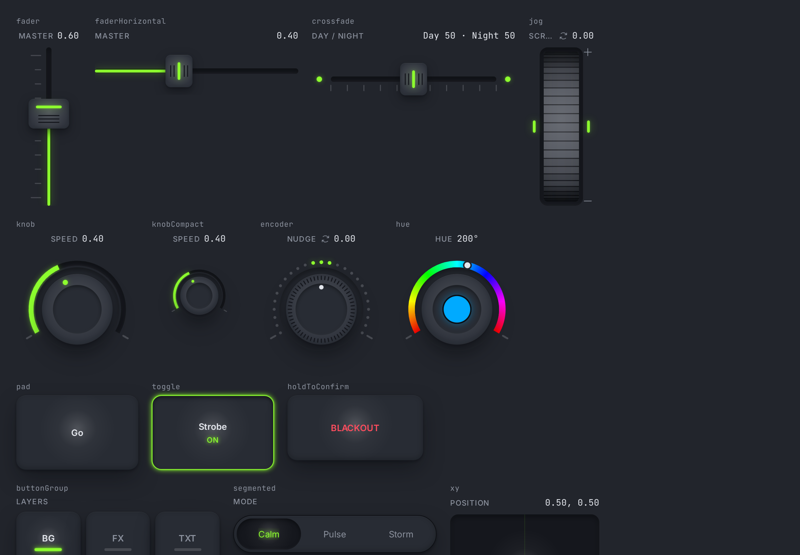
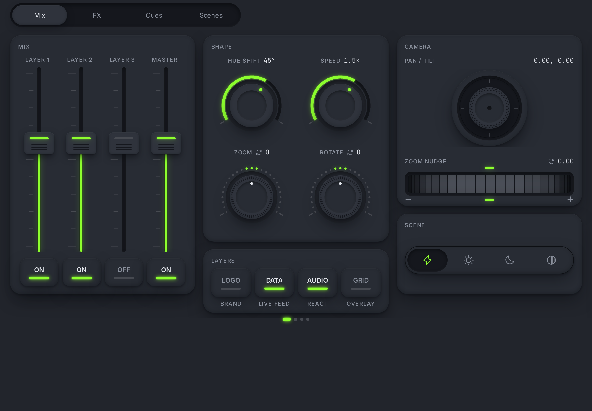
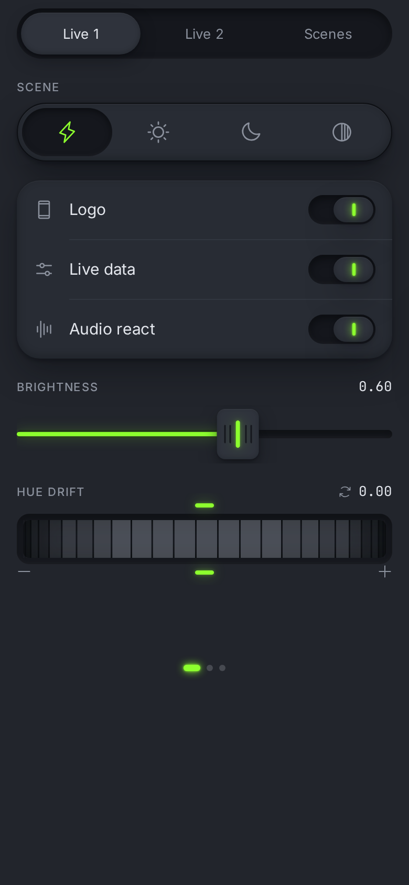

# Otakoyi Controls

The design system behind **Otakoyi Control**, the controller app for our studio's generative
installations. The app turns a phone or tablet into a branded control surface (we call it a
_pult_), and the pult sends OSC to TouchDesigner. This repository holds the design system:
tokens, control logic and every component, documented in Storybook. It is the single source of
the design system: the app, the bridge and the studio tools live in a private repo that checks this
one out as a git submodule.

**[Storybook →](https://otakoyi-controls.vercel.app)** · Live preview:
[all controls](https://otakoyi-controls.vercel.app/iframe.html?id=controls-touch-light--all-controls&viewMode=story)
· [tablet VJ console](https://otakoyi-controls.vercel.app/iframe.html?id=pult-pult-pager--panels-vj-console&viewMode=story)
· [phone pult](https://otakoyi-controls.vercel.app/iframe.html?id=pult-pult-pager--panels-lobby-phone&viewMode=story)



## What's inside

| Package             | What it is                                                                                 |
| ------------------- | ------------------------------------------------------------------------------------------ |
| `packages/tokens`   | `tokens.json` → CSS variables, Tailwind preset and `createTheme(brand)`; Figma brand modes |
| `packages/ui`       | ~100 components: 20+ controls on Skia, app chrome on React Native Reusables + NativeWind   |
| `packages/controls` | Pure TS control logic: value mapping, relative/absolute modes, throttling, OSC messages    |
| `packages/schema`   | zod schema of a pult config (what Figma exports and the app renders)                       |
| `packages/osc-core` | OSC 1.0/1.1 codec, bundles, SLIP                                                           |
| `apps/storybook`    | The docs: every component × state, theme, brand and phone/tablet viewport                  |

Controls: fader (vertical, horizontal, crossfade, relative jog), knob, encoder, hue ring, jog wheel,
XY pad, thumbstick, gyroscope, meter, pads, toggles, hold-to-confirm, segmented, button group,
colour picker, scene list, image and prompt controls.



## How it works

- **Figma first.** Every component and screen exists in Figma before it is coded. Figma names are
  the code API: `Button · Variant=Primary` is `<Button variant="primary" />`. The table of
  components and Figma nodes is in [docs/figma.md](docs/figma.md).
- **Tokens only.** Colour, spacing, radii, type and motion come from `@osc/tokens`. Skia controls
  read `useTheme()`, NativeWind classes use semantic names. No hex in components.
- **Brand is not status.** A client brand can change primary, accent, neutrals, font and logo.
  Status colours (online, warning, critical, offline) never change.
- **The pult never scrolls.** Controls are packed at their Figma sizes; what doesn't fit goes to
  the next screen you swipe to. The layout logic is pure TS with tests.
- **Logic is tested, components only draw.** Anything that decides what gets sent lives in
  `packages/controls` and has unit tests.
- **Checks catch drift.** CI renders all 326 stories in both themes in headless Chromium, runs the
  play tests and a layout sensor (a sheet header never covers its content, nothing is cut off).
  `pnpm verify` also fails when the generated token files fall behind `tokens.json`.

Design decisions are written down in [docs/decisions](docs/decisions).



## Run it

```bash
pnpm install
pnpm storybook         # http://localhost:6006
pnpm verify            # tokens check, formatting, types, unit tests
pnpm build-storybook && pnpm test-storybook   # every story × dark/light, play tests, layout sensor
```

Stack: React Native 0.88 + React Native Web, TypeScript, Skia, Reanimated, Gesture Handler,
NativeWind 4, React Native Reusables, Storybook 10, Vitest, Playwright.

## Context

Otakoyi is a studio that makes generative installations for events and public spaces. The app,
the bridge that runs on the installation machine and the Figma exporter live in a private product
repository; this is the public part.

Design and engineering: [Yura Danylov](https://www.linkedin.com/in/yuradanilov/). Most of the code
was written with Claude Code under agent rules and the checks above; the system, the design and
every decision are mine.

© Otakoyi studio. Shown as a portfolio piece; not licensed for reuse. Components in
`packages/ui/src/components/ui` are based on React Native Reusables (MIT, see the licence file
there).
